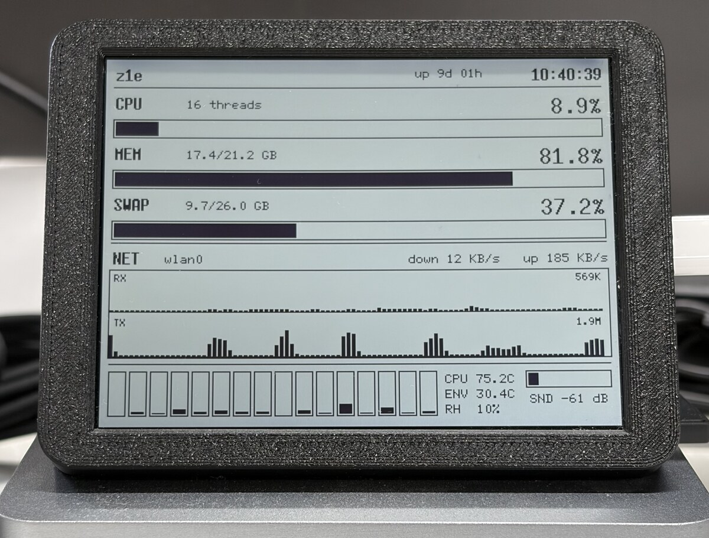

# RLCD Dashboard

**English** · [简体中文](README.zh-CN.md)

Stream this machine's CPU, memory, network and ambient-sound levels to a
[Waveshare ESP32-S3-RLCD-4.2](https://www.waveshare.com/esp32-s3-rlcd-4.2.htm) —
a 4.2", 300×400 **reflective** LCD that stays readable in direct sunlight and
draws almost nothing when nothing changes.

<!-- Drop a photo at docs/screenshot.jpg and it shows up here. -->


A small host daemon (Rust, ~0.5 % of one core, 2.6 MB RSS) samples `/proc` and
pushes a 167-byte binary frame over the board's native USB serial at 10 Hz. The
board parses the frame and redraws the panel. Rendering lives on the device, so
the link never has to be fast or jitter-free.

## What it shows

| Area | Content |
| --- | --- |
| Header | hostname, uptime, wall clock |
| Gauges | CPU %, memory %, swap % (hatched when nearly full) |
| Network | primary interface, down/up rate, 48-second rate graph with auto-ranging |
| CPU cores | 16 bars (more cores are folded into 16 buckets by max) |
| Right column | host CPU temperature, on-board temperature/humidity (SHTC3), ambient sound level (ES7210 mic array) in dBFS |

Two themes: **black on white** (default — a reflective panel reflects ambient
light, so a white background is brighter) and white on black. Press the **KEY**
button (GPIO18) to switch; the choice is stored in NVS and survives power
cycles.

## Hardware

- Waveshare **ESP32-S3-RLCD-4.2** (ESP32-S3-WROOM-1-N16R8, 16 MB flash, 8 MB PSRAM)
- Display: ST7305, 300×400, 1-bit, reflective
- Sensors used: SHTC3 (I²C 0x70), ES7210 mic ADC (I²C 0x40)
- Anything with a USB port on the host side

No wiring is needed — everything above is on the board.

## Quick start

```bash
git clone https://github.com/<you>/rlcd-dashboard.git
cd rlcd-dashboard

# 1. Arduino ESP32 toolchain + U8g2 (downloads ~890 MB, resumable)
scripts/fetch-toolchain.sh

# 2. Build and flash the firmware
scripts/flash.sh                     # /dev/ttyACM0 by default

# 3. Build the host daemon
scripts/fetch-rust.sh                # needs a C toolchain: sudo oma install devel-base
scripts/build-host.sh

# 4. Run it once to check
scripts/run.sh

# 5. Or install it as a service
sudo scripts/install-service.sh
```

`sudo scripts/install-service.sh` installs a systemd **system** unit that runs as
you, with `SupplementaryGroups=dialout` for serial access. No udev rule and no
group change needed; it keeps retrying if the board is not plugged in yet.

Requirements: `arduino-cli` (fetched), a C toolchain for Rust linking, and
Python 3 only if you want the reference host or the serial monitor.

## How it works

```
┌──────────────────────────────┐            ┌─────────────────────────────┐
│  host (Rust)                 │   USB CDC  │  ESP32-S3                   │
│  /proc + /sys  ──► 167 B     │ ─────────► │  parse → draw → ST7305      │
│  @ 10 Hz, 1.7 KB/s           │  172 B/f   │  400×300 canvas, u8g2       │
└──────────────────────────────┘            └─────────────────────────────┘
```

Frame layout (little endian):

```
A5 5A <len:u8> <payload:len> <crc16:u16>      len = 167
crc16 = CRC-16/CCITT-FALSE over the payload
```

The payload is a packed struct defined once in
[`firmware/rlcd_dash/protocol.h`](firmware/rlcd_dash/protocol.h) and mirrored in
[`host-rust/src/proto.rs`](host-rust/src/proto.rs). Both sides assert the size,
and the Rust tests pin every field offset, so a layout change fails loudly
instead of silently corrupting the display.

Sending numbers rather than pixels is the whole point: a 1-bit 400×300 bitmap at
10 Hz would be 150 KB/s, while 167 bytes per frame is 1.7 KB/s. The link is
therefore irrelevant to timing, and the panel keeps refreshing on its own.

## Repository layout

```
firmware/rlcd_dash/     Arduino sketch: ST7305 driver, dashboard, SHTC3, ES7210
firmware/rlcd_dash/src/ Vendored esp_codec_dev subset (ES7210 only), Apache-2.0
host-rust/              Host daemon (Rust, one dependency: libc)
host/rlcd_host.py       Reference host implementation, same wire format
diagnostics/audio_probe Vendor audio stack, unmodified — for bisecting audio bugs
packaging/              systemd unit template
scripts/                Toolchain, build, flash, run, service install
docs/                   Screenshot
```

## Measured

On an AMD Ryzen Z1 Extreme running the board over its native USB:

| | |
| --- | --- |
| Host CPU | 0.52 % of one core |
| Host RSS | 2.6 MB |
| Link | 172 B/frame × 10 Hz = 1.7 KB/s, 0 dropped over 2.7 days |
| Panel refresh ceiling | ~58 fps when fed 60–100 Hz (6× headroom at 10 Hz) |
| Firmware | 397 KB (12 % of the 3 MB app partition) |
| Log volume | ~2 lines/minute when everything is fine |

Frame rate is configurable (`--hz`, 1–100); the graph window stays 48 seconds
regardless because history is binned by wall clock, not by frame count.

## Configuration

```bash
scripts/run.sh --help
  -p, --port <DEV>        serial device            [default: /dev/ttyACM0]
  -r, --hz <HZ>           frame rate               [default: 10]
  -i, --iface <NAME>      force a network interface (default: auto)
      --temp <PATH>       force a temperature sensor (default: auto)
      --wait <SECS>       wait for the device, 0 = forever
      --report-every <S>  seconds between send summaries, 0 = off [default: 60]
  -q, --quiet             do not print board status lines
      --dry-run           sample only, do not open the serial port
```

Build options live in [`scripts/env.sh`](scripts/env.sh) — override `FQBN`,
`PORT` or `BUILD_DIR` via the environment.

## Troubleshooting

| Symptom | Fix |
| --- | --- |
| `Permission denied: /dev/ttyACM0` | Only affects running `scripts/run.sh` by hand. `chmod 666` is temporary — it is lost on re-enumeration. Install the udev rule in [docs/udev.md](docs/udev.md), or just use the systemd service, which does not need it. |
| Blank or garbled screen | Check the boot banner over serial for `rlcd_dash ready`; a failed flash is the usual cause. |
| `NO HOST SIGNAL` forever | The host is not running, or `Serial` is not on USB — verify `CDCOnBoot=cdc` in the FQBN. |
| CPU temperature stuck at a fake value (e.g. 20 °C) | The wrong `/sys/class/hwmon` sensor was picked. The startup banner prints which one; force it with `--temp`, e.g. `.../hwmon3/temp1_input`. |
| Sound meter reads nothing | Run `diagnostics/audio_probe` first — it drives the mics through the vendor stack. If it also reads silence, the problem is hardware, not this code. |
| Flash aborts with `device descriptor read/64, error -71` | USB dropout (cable/power). The image is often already written — read the serial banner before reflashing. |

## Notes on the hardware

Three things cost real time to figure out; they are documented here so nobody
has to rediscover them.

- **ST7305 RAM is not byte-per-row.** It packs a 4-column × 2-row block into one
  byte (MSB pair = leftmost column, upper bit of each pair = upper row), and
  addresses columns in units of 12 pixels. The repacking happens in
  `st7305_u8g2.cpp`.
- **The ES7210's gain registers get clobbered.** `es7210_codec_new()` runs the
  init sequence, but `enable()` → `start()` → `mic_select()` rewrites the gain
  from a `codec->gain` field the driver never assigns (0 after `calloc`), so the
  open-time 30 dB becomes 0 dB. It must be set *after* `enable()`. That is the
  entire difference between a working mic and digital silence.
- **`acpitz` lies.** ACPI thermal zones often report a flat, invented value and
  usually sit at `hwmon0`. Sensor selection is priority-ordered by chip name
  (`k10temp`, `coretemp`, …) rather than by hwmon index.

## Contributing

Issues and pull requests are welcome. Before sending a patch:

```bash
scripts/build.sh                                   # firmware compiles
cd host-rust && cargo test --release                # 6 unit tests
python3 scripts/verify-rust-proto.py                # cross-checks Rust output
                                                    # against the Python decoder
```

The last one matters when touching `protocol.h` or `proto.rs`: it runs the Rust
binary against a PTY and decodes its frames with the Python implementation,
which is the only automated guard against the two ends drifting apart.

## License

[Apache-2.0](LICENSE). Third-party components and what was changed from upstream
are listed in [NOTICE](NOTICE).