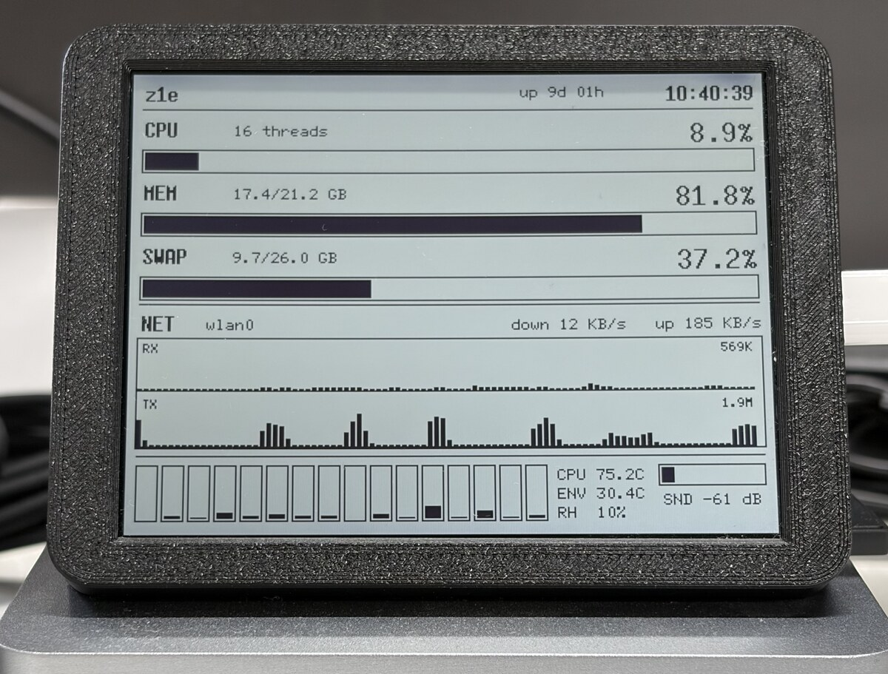

# Waveshare ESP32-S3-RLCD-4.2 仪表盘

[English](README.md) · **简体中文**

把这台机器的 **CPU / 内存 / 网络 / 环境音量** 实时推到一块
[Waveshare ESP32-S3-RLCD-4.2](https://www.waveshare.com/esp32-s3-rlcd-4.2.htm) 上。
4.2 寸、300×400 的**全反射**屏，强光下反而更清楚，画面不变时几乎不耗电。
和电子墨水屏不同，它刷新得足够快，可以画实时曲线——实测满屏刷新能稳定跑到约 58 fps。

<!-- 把实物照片放到 docs/screenshot.jpg 就会显示在这里 -->


主机端是一个小守护进程（Rust，约 **0.5 % 单核**、2.6 MB 常驻），从 `/proc` 采样后
把 167 字节的二进制帧按 10 Hz 通过板载原生 USB 串口发出去；板子解析后自己绘制。
**渲染放在设备端**，所以串口链路既不需要快，也不用担心抖动。

## 显示内容

| 区域 | 内容 |
| --- | --- |
| 表头 | 主机名、uptime、本地时间 |
| 仪表 | CPU / 内存 / swap 占用率（接近写满时变成斜纹填充） |
| 网络 | 主网卡、上下行速率、48 秒速率柱状图（自动量程） |
| CPU 核心 | 16 根柱（超过 16 核时按最大占用折叠成 16 组） |
| 右侧 | 主机 CPU 温度、板载温湿度（SHTC3）、环境音量（ES7210 麦克风阵列，dBFS） |

两种主题：**白底黑字**（默认——全反射屏靠反射环境光，白底更亮）和黑底白字。
按 **KEY** 键（GPIO18）切换，选择写进 NVS，掉电和重烧固件都不丢。

## 硬件

- Waveshare **ESP32-S3-RLCD-4.2**（ESP32-S3-WROOM-1-N16R8，16 MB flash、8 MB PSRAM）
- 屏幕：ST7305，300×400，1-bit，全反射
- 用到的传感器：SHTC3（I²C 0x70）、ES7210 麦克风 ADC（I²C 0x40）
- 主机端任意有 USB 口的机器

**不需要任何接线**，上面这些都在板子上。

## 快速开始

```bash
git clone https://github.com/<you>/waveshare-esp32-s3-rlcd-4.2-dashboard.git
cd waveshare-esp32-s3-rlcd-4.2-dashboard

# 1) Arduino ESP32 工具链 + U8g2（约 890 MB，可断点续传）
scripts/fetch-toolchain.sh

# 2) 编译并烧录固件
scripts/flash.sh                     # 默认 /dev/ttyACM0

# 3) 编译主机端
scripts/fetch-rust.sh                # 需要 C 工具链：sudo oma install devel-base
scripts/build-host.sh

# 4) 先手动跑一次
scripts/run.sh

# 5) 或者装成服务
sudo scripts/install-service.sh
```

`install-service.sh` 装的是 systemd **系统**单元，以你自己的账号运行，靠
`SupplementaryGroups=dialout` 拿到串口权限——**不需要 udev 规则，也不用改用户组**；
板子还没插上时会一直重试。

依赖：`arduino-cli`（脚本会下）、Rust 链接需要 C 工具链；Python 3 只在你想用
参考实现或串口监视器时才需要。

## 工作原理

```
┌──────────────────────────────┐            ┌─────────────────────────────┐
│  主机 (Rust)                  │   USB CDC  │  ESP32-S3                   │
│  /proc + /sys  ──► 167 B     │ ─────────► │  解析 → 绘制 → ST7305        │
│  10 Hz，1.7 KB/s              │  172 B/帧  │  400×300 画布，u8g2         │
└──────────────────────────────┘            └─────────────────────────────┘
```

帧格式（小端）：

```
A5 5A <len:u8> <payload:len> <crc16:u16>      len = 167
crc16 = CRC-16/CCITT-FALSE，只覆盖 payload
```

payload 是一个 packed struct，定义在
[`firmware/rlcd_dash/protocol.h`](firmware/rlcd_dash/protocol.h)，
并在 [`host-rust/src/proto.rs`](host-rust/src/proto.rs) 里镜像一份。两端都断言了长度，
Rust 的单元测试还锁死了每个字段的偏移——布局一改就立刻报错，而不是悄悄画出乱码。

**发数字而不是发像素**是关键：1-bit 的 400×300 位图按 10 Hz 算是 150 KB/s，
而一帧 167 字节只有 1.7 KB/s。于是链路和时序彻底解耦，屏幕自己也能继续刷新。

## 目录结构

```
firmware/rlcd_dash/     Arduino sketch：ST7305 驱动、仪表盘、SHTC3、ES7210
firmware/rlcd_dash/src/ vendored 的 esp_codec_dev 子集（只有 ES7210，Apache-2.0）
host-rust/              主机守护进程（Rust，唯一依赖 libc）
host/rlcd_host.py       同协议的 Python 参考实现
diagnostics/audio_probe 厂商原版音频栈，未改动——用于二分音频问题
packaging/              systemd 单元模板
scripts/                工具链、编译、烧录、运行、装服务
docs/                   截图
```

## 实测

在一台 AMD Ryzen Z1 Extreme 上，板子走原生 USB：

| | |
| --- | --- |
| 主机 CPU | **0.52 %** 单核 |
| 主机常驻内存 | 2.6 MB |
| 链路 | 172 B/帧 × 10 Hz = 1.7 KB/s，连续 2.7 天 0 丢帧 |
| 面板刷新手平 | 喂 60–100 Hz 时约 58 fps（10 Hz 有 6× 余量） |
| 固件大小 | 397 KB（3 MB app 分区的 12 %） |
| 日志量 | 一切正常时约 2 行/分钟 |

帧率可调（`--hz`，1–100）；但柱状图窗口恒为 48 秒，因为历史是按墙钟分格而不是按帧数。

## 配置

```bash
scripts/run.sh --help
  -p, --port <DEV>        串口设备              [默认: /dev/ttyACM0]
  -r, --hz <HZ>           帧率                  [默认: 10]
  -i, --iface <NAME>      指定网卡              [默认: 自动]
      --temp <PATH>       指定温度传感器         [默认: 自动]
      --wait <SECS>       等待设备，0 = 一直等
      --report-every <S>  每隔几秒打印发送汇总，0 = 关 [默认: 60]
  -q, --quiet             不打印板子回传的 STAT
      --dry-run           只采集，不开串口
```

编译参数在 [`scripts/env.sh`](scripts/env.sh)，可以用环境变量覆盖 `FQBN`、`PORT`、
`BUILD_DIR`。

## 排错

| 现象 | 处理 |
| --- | --- |
| `Permission denied: /dev/ttyACM0` | 只影响手动跑 `scripts/run.sh`。`chmod 666` 是临时的，设备一重新枚举就失效。要么按 [docs/udev.md](docs/udev.md) 装 udev 规则，要么直接用 systemd 服务——那个不需要。 |
| 屏幕空白或花屏 | 看串口启动横幅有没有 `rlcd_dash ready`，多半是没烧成功。 |
| 一直 `NO HOST SIGNAL` | 主机没跑，或 `Serial` 没走 USB——检查 FQBN 里有没有 `CDCOnBoot=cdc`。 |
| CPU 温度是个不动的假值（比如 20 °C） | 选错了 `/sys/class/hwmon` 传感器。启动横幅会打印实际选中的那一路，用 `--temp` 强制指定，例如 `.../hwmon3/temp1_input`。 |
| 音量条没反应 | 先跑 `diagnostics/audio_probe`——它用厂商原版栈驱动麦克风。如果它也是静音，那就是硬件问题，不是这里的代码。 |
| 烧录时报 `device descriptor read/64, error -71` | USB 掉线（线材/供电）。镜像通常已经写进去了，先读串口横幅再决定要不要重烧。 |

## 硬件上的三个坑

这几处花了不少时间才搞清楚，记在这里免得别人再踩一遍。

- **ST7305 的显存不是一行一字节。** 它把 **4 列 × 2 行**打成一个字节（最高位那对 =
  最左列，每对的高位 = 上行），而且列地址粒度是 12 像素。重打包在
  `st7305_u8g2.cpp` 里。
- **ES7210 的增益寄存器会被覆盖。** `es7210_codec_new()` 会跑一遍初始化，但
  `enable()` → `start()` → `mic_select()` 会用 `codec->gain` 重写增益寄存器，
  而这个字段驱动里从来没赋过值（`calloc` 出来是 0），于是 open 时设的 30 dB 变成
  **0 dB**。必须在 `enable()` **之后**再设一次。这一行就是"麦克风正常工作"和
  "只有数字静音"的全部差别。
- **`acpitz` 会撒谎。** ACPI 热区经常报一个固定的、凭空捏造的值，而且通常排在
  `hwmon0`。所以选传感器是**按芯片名优先级**（`k10temp`、`coretemp`……）而不是按
  hwmon 序号。

## 参与贡献

欢迎 issue 和 PR。提交前请跑：

```bash
scripts/build.sh                                   # 固件能编过
cd host-rust && cargo test --release                # 6 个单元测试
python3 scripts/verify-rust-proto.py                # Rust 输出与 Python 解码器对拍
```

最后一个在改 `protocol.h` 或 `proto.rs` 时尤其重要：它把 Rust 二进制挂到 PTY 上，
用 Python 实现把帧解回来——这是唯一能自动发现两端协议跑偏的手段。

## License

[Apache-2.0](LICENSE)。第三方组件以及相对上游改了什么，见 [NOTICE](NOTICE)。